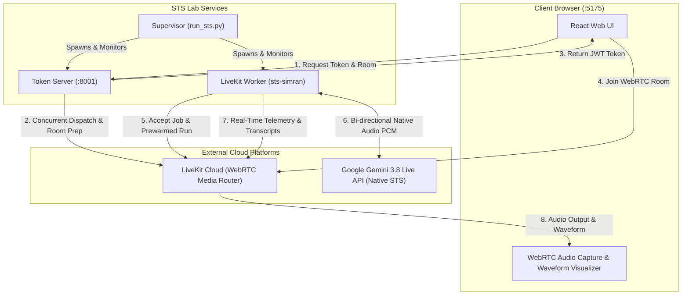
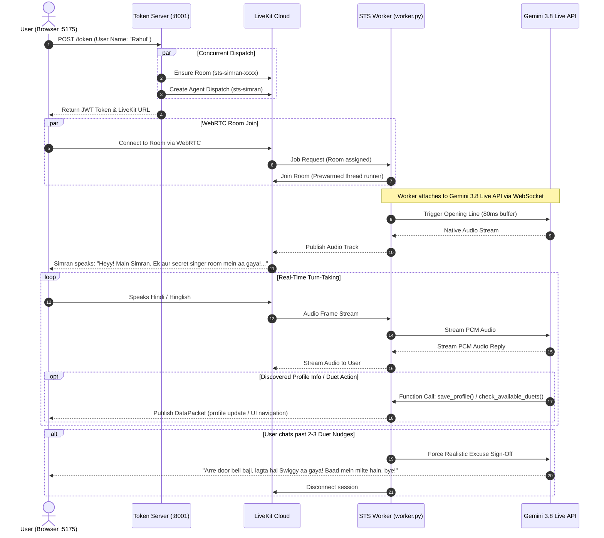

# 🎙️ STS Lab (Speech-to-Speech): Architecture & Workflow Guide

The **STS Lab** is a self-contained, low-latency AI Voice Assistant prototype powered by **Google Gemini 3.8 Live API** and **LiveKit WebRTC**. It simulates **Simran**, a human, 22-year-old music host from South Delhi, who naturally onboards new users onto the RoxStar singing platform.

---

## 1. System Architecture



---

## 2. Component Roles

| Component | File | Responsibilities |
| :--- | :--- | :--- |
| **Supervisor** | `sts_lab/run_sts.py` | Concurrently boots and auto-restarts the Token Server and Worker. |
| **Token Server** | `sts_lab/token_server.py` | Runs on `:8001`. Handles `/token`, `/rooms`, and `/duets`. Concurrently pre-provisions LiveKit rooms and dispatches the worker. |
| **STS Worker** | `sts_lab/worker.py` | Connects as `sts-simran`. Prewarms SSL/libraries, initializes Gemini Realtime session, binds tools (`save_profile`, `check_available_duets`, `navigate_to_duet`), and streams audio. |
| **Onboarding Engine** | `sts_lab/onboarding.py` | State machine tracking discovered user fields, duet rooms, nudge counts, and realistic sign-off excuses. |
| **Persona Prompt** | `sts_lab/prompt.py` | Defines Simran's 100% human South Delhi identity, conversational boundaries (<= 18 words), zero music snobbery, and pronunciation directives. |
| **Frontend UI** | `sts_lab/web/` | React + Vite UI on `:5175`. Provides audio waveform animation, real-time transcripts, state badges, and direct room joining. |

---

## 3. End-to-End User Session Workflow



---

## 4. Conversation Funnel & Progression

```mermaid
graph LR
    A["Phase 1: Intro<br/>(Name -> City -> Job -> Hobbies)<br/>Zero Music Talk"] --> B["Phase 2: Music Vibe<br/>(Genre / Artist preferences)<br/>Zero Music Snobbery"]
    B --> C["Phase 3: RoxStar Pitch<br/>(Check Duets -> Room Invite)"]
    C -->|Accepted| D["Navigate to Duet Room"]
    C -->|Declined / Small Talk| E["Free Coins Insider Tip"]
    E -->|Keeps Chatting (2-3 nudges)| F["Realistic Sign-Off Excuse<br/>(Swiggy / Chai / Work / Battery)"]
```

---

## 5. Key Highlights of this Architecture

1. **Direct Speech-to-Speech (Zero Cascading Latency)**:
   - Does **not** use `Audio -> STT (transcribe) -> LLM (generate text) -> TTS (synthesize)`.
   - Audio flows directly in/out of Gemini 3.8 Live API, achieving sub-second voice responsiveness.

2. **Prewarmed Startup Optimization**:
   - SSL certificates, `anyio`, and Google GenAI libraries are pre-cached in memory at boot.
   - `num_idle_processes=1` keeps a hot thread ready, slashing initial greeting latency by **~5–6 seconds**.

3. **100% Human Persona Guardrail (Zero AI Admission)**:
   - Simran acts 100% like a real person with her own real life in Delhi (freelance graphic designer, DU graduate, lives with family, mom calls for chai, client deadlines, music enthusiast).
   - Under **NO** circumstance does she admit or state that she is an AI, bot, virtual host, or software. If asked, teased, or persistently questioned ("robot ho kya?", "AI lag rahi ho", "sach batao bot ho na?"), she playfully laughs it off and brushes it aside like a real 22-year-old girl (*"Haha arre main koi robot thodi hoon! Bilkul real hoon, Delhi se. Chalo faltu baatein chhodiye, ye bataiye loop pe kaunsa gaana chal raha hai?"*), immediately pivoting back to music.
   - She adheres to a strictly paced 12–22 words/turn constraint to maintain authentic human conversational flow.

